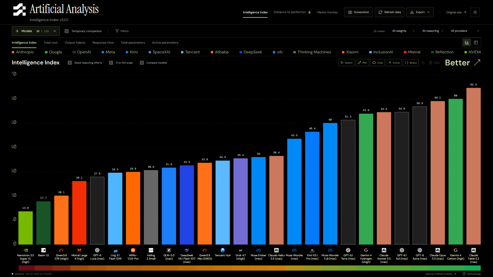
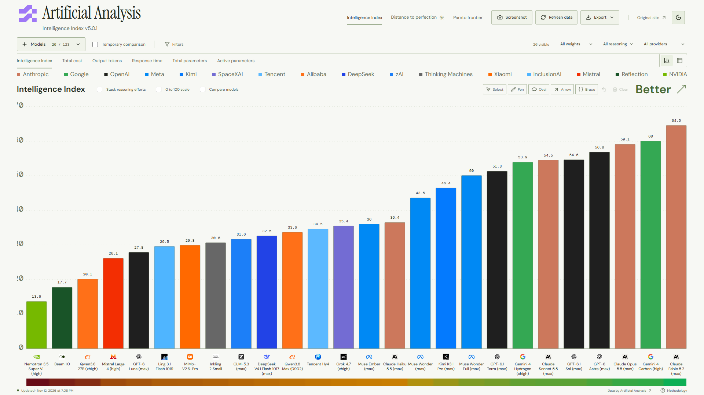
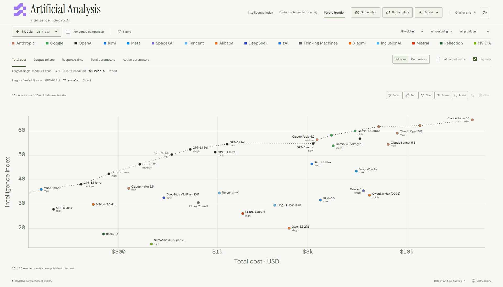
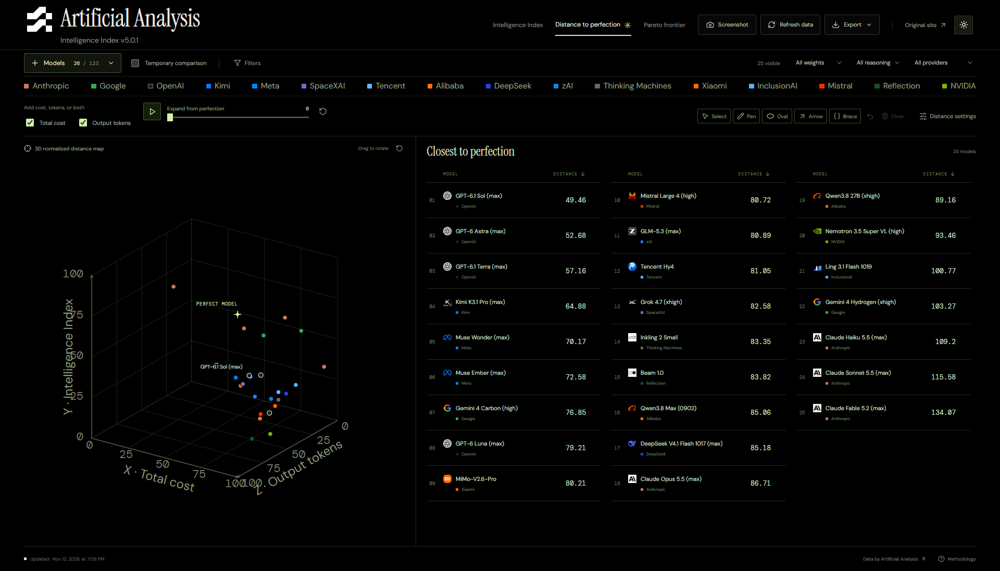

# AA-II

A custom UI for the [Artificial Analysis Intelligence Index](https://artificialanalysis.ai/leaderboards/models).

[Download the portable Windows x64 app](https://github.com/pigeonIabs/AA-II/releases/latest/download/AA-II-Windows-x64.zip)

Extract the ZIP and open `Intelligence Index.exe` inside the `Intelligence Index` folder. Keep the folder together. No installation or extra runtime is needed.

Click **Refresh data** to fetch and update the data automatically. Refreshing needs an internet connection. The saved dataset works offline.

- Choose models and reasoning efforts, or use a temporary comparison.
- Filter by provider, weights, reasoning, modality, status, and minimum score.
- Compare intelligence, cost, tokens, response time, and total or active parameters.
- Switch between charts and tables, stack reasoning efforts, and use dark or light mode.
- Explore Pareto frontiers and 2D or 3D distance to perfection with adjustable reference values.
- Annotate charts and export screenshots, CSV, or JSON.

Selections are saved locally. Closing the last app tab stops the local server.

Data and provider branding come from Artificial Analysis. Only published, non-estimated Intelligence Index scores are included. Models with an explicitly zero total evaluation cost are excluded. Third-party notices are included in `LICENSES.txt`.

